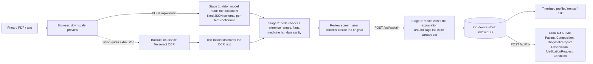

# Sehat Copilot

AI-powered personal health copilot. Upload a prescription, lab report or discharge summary; it reads the document, checks every value against reference ranges, explains it in plain English or Hindi, and files it into one health profile and timeline. Records export as an ABDM-style FHIR bundle.

Built by team ANTIJAREX for HacXLerate 2026 Round 1 (Altrix Labs challenge: AI-Powered Personal Health Copilot).

> Sehat Copilot explains records. It does not diagnose and is not a substitute for a doctor.

## What it does

| Brief requirement | Where |
|---|---|
| Medical record intelligence and OCR | Add record: photo, PDF or text in; medicines, doses, test values, diagnoses and dates out, each with a confidence score |
| Summary in simple language | Every record gets a summary, a meaning for each abnormal value, the purpose of each medicine and questions to ask the doctor |
| Unified health profile | Timeline, conditions, current medicines, latest values and trend charts across reports |
| Multi-language (bonus) | English and Hindi interface and summaries; Hindi and mixed-language documents are read |
| ABDM/ABHA readiness (bonus) | FHIR R4 bundle export shaped on NRCeS profiles; mock ABHA link and import |

## Architecture



Design decisions:

- **Code decides, the model writes.** Whether a value is low, high or critical is computed in `ranges.py` from the range printed on the report (or a standard table when none is printed). The model only words the explanation and cannot change a flag.
- **Numeric guard.** After the model writes an explanation, every number in its text is checked against the verified record. A sentence containing a number that is not in the record (an invented target or range, say) is replaced by a plain factual template.
- **Safety gate before the model.** Questions are screened in code first (`safety.py`): emergency wording gets a fixed reply pointing to 112, then questions about stopping, skipping or changing a medicine get a fixed "ask your prescriber" reply. Neither reaches a model.
- **Labelled answers.** Each chat answer is marked "From your records", "General information" or "Ask your doctor". The first is only shown when the answer cites a saved record.
- **Human in the loop.** Nothing is saved until the user has seen the extraction next to the original. Items read with low confidence, handwritten documents and medicines not in the reference list are marked for checking.
- **Local-first storage.** Records and original files stay in the browser (IndexedDB). The server is stateless: it reads, checks, explains and converts, and stores nothing.
- **ABDM-ready schema.** Each document maps to one Composition (PrescriptionRecord, DiagnosticReportRecord or DischargeSummaryRecord) referencing its Observations (LOINC-coded where known), MedicationRequests and Conditions. The ABHA number is carried as a Patient identifier.
- **Degrades instead of failing.** Model chains per provider; when no vision model is available the page reads the image on-device and a text model structures it, marked as lower confidence.

## Stack

Python 3 standard library server (no framework), vanilla JS frontend, Gemini (document reading), Groq (writing), NVIDIA NIM and OpenRouter (fallback readers and writers), Tesseract.js (backup OCR), deployed on Vercel.

| File | Role |
|---|---|
| `server.py`, `api/index.py` | HTTP API, local and Vercel entry |
| `pipeline.py` | extract, check, explain, overview, ask |
| `ranges.py` | reference ranges, LOINC codes, flagging |
| `fhir.py` | FHIR R4 bundle builder |
| `llm.py` | model calls and fallback chains |
| `safety.py` | emergency and medication gate, numeric guard |
| `tests/` | unit tests for the gate, labels and guard (`python -m unittest discover tests`) |
| `public/` | the app |
| `tools/` | sample-document generator, demo builder, model check |

## Run locally

```bash
python server.py
```

Then open http://localhost:8820. Needs a `.env` with `GEMINI_API_KEY` and `GROQ_API_KEY`; `NVIDIA_API_KEY` and `OPENROUTER_API_KEY` are optional fallbacks.

## What is real and what is mocked

- Real: document reading, range checking, explanations, timeline, trends, questions over records, FHIR export.
- Mocked: the ABHA link and import. It validates the number format and returns canned records; it does not call the ABDM sandbox.
- Sample documents are synthetic (one fictional patient) and generated by `tools/make_samples.py`. The demo profile is the saved output of running the real pipeline over them (`tools/build_demo.py`).
- Reference ranges are general adult ranges for explanation only.
- DRAFT: the Hindi safety replies and Hindi template sentences were written by the team with AI help and have not been reviewed by a clinician or a professional translator.
- Untested: the in-browser Tesseract fallback has not been exercised end to end in a browser.

## Prior work

`data/medicines.json` (135 medicine names, classes and uses) comes from our own earlier project, CarePath. Everything else in this repository was written during the hackathon, with AI coding assistance as the rules allow.
