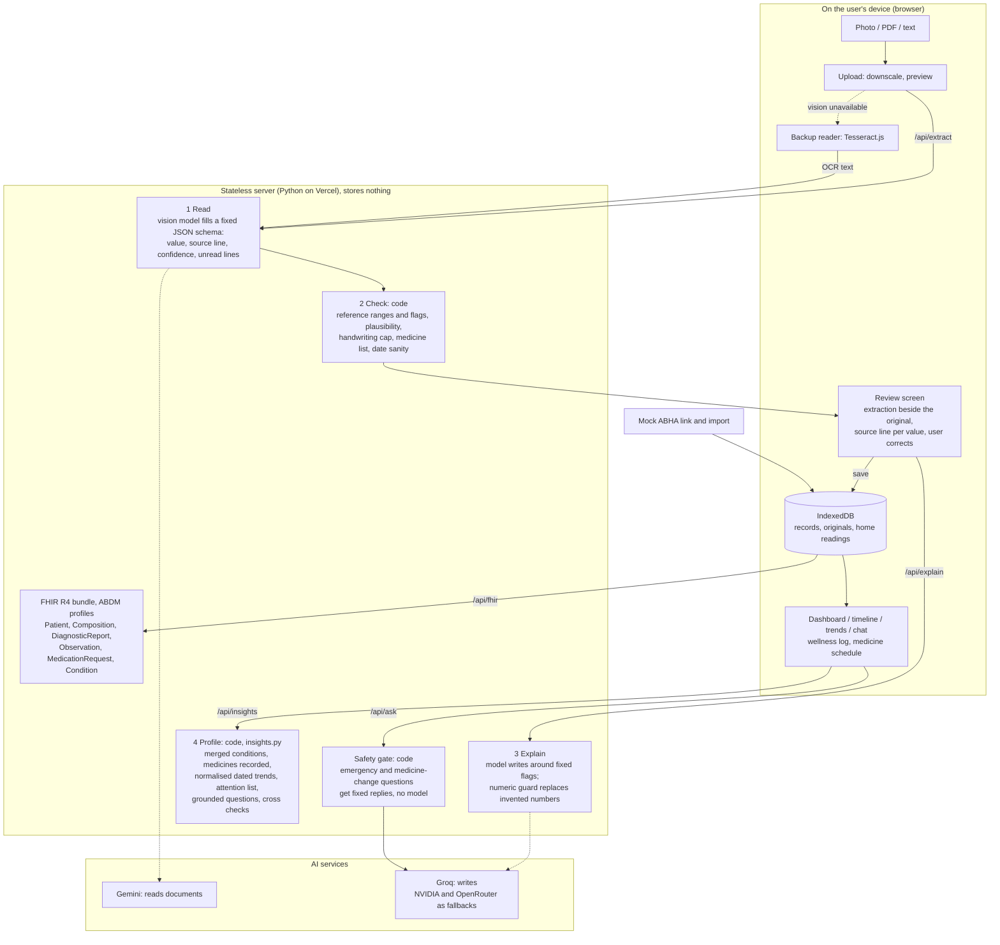

# Sehat Copilot

AI-powered personal health copilot. Upload a prescription, lab report or discharge summary; it reads the document, checks every value against reference ranges, explains it in plain English or Hindi, and files it into one health profile and timeline. Records export as an ABDM-style FHIR bundle.

Built by team ANTIJAREX for HacXLerate 2026 Round 1 (Altrix Labs challenge: AI-Powered Personal Health Copilot).

> Sehat Copilot explains records. It does not diagnose and is not a substitute for a doctor.

## What it does

| Brief requirement | Where |
|---|---|
| Medical record intelligence and OCR | Add record: photo, PDF or text in; medicines, doses, test values, diagnoses and dates out, each with a confidence score |
| Summary in simple language | Every record gets a summary, a meaning for each abnormal value, the purpose of each medicine and questions to ask the doctor |
| Unified health profile | Timeline, conditions, current medicines, latest values and trend charts across reports |
| Multi-language (bonus) | 43 languages: ten ship ready (English, Hindi, Bengali, Telugu, Marathi, Tamil, Gujarati, Kannada, Malayalam, Punjabi), the rest are translated on demand. Summaries and chat are written in the chosen language; Hindi, mixed-language and handwritten documents are read |
| Wellness data | A log for home readings (blood pressure, sugar, weight, pulse) with code-decided flags and trends, shown beside the lab results and exported as FHIR vital signs |
| Guide on every screen | Saathi, a floating helper with a tip for the current screen and a chat that shares the Ask page's safety gate |
| ABDM/ABHA readiness (bonus) | FHIR R4 bundle export shaped on NRCeS profiles; mock ABHA link and import |

## Architecture



Design decisions:

- **Code decides, the model writes.** Whether a value is low, high or critical is computed in `ranges.py` from the range printed on the report (or a standard table when none is printed). The model only words the explanation and cannot change a flag.
- **Numeric guard.** After the model writes an explanation, every number in its text is checked against the verified record. A sentence containing a number that is not in the record (an invented target or range, say) is replaced by a plain factual template.
- **Safety gate before the model.** Questions are screened in code first (`safety.py`): emergency wording gets a fixed reply pointing to 112, then questions about stopping, skipping or changing a medicine get a fixed "ask your prescriber" reply. Neither reaches a model.
- **Labelled answers.** Each chat answer is marked "From your records", "General information" or "Ask your doctor". The first is only shown when the answer cites a saved record.
- **Every value is traceable.** The reader returns the exact line each test and medicine was read from; the review screen shows it under the value and beside the original when the value is clicked.
- **Impossible values are caught.** A value no living adult has (HbA1c of 76 %, say) is treated as a misread, usually a lost decimal point: it is never shown as critical, its confidence drops to the "please verify" level and the user is asked to correct it from the original.
- **Handwriting is never trusted.** For a handwritten document every item is capped below the "please verify" line, whatever confidence the model reports.
- **Nothing is guessed.** Lines that look like data but could not be read reliably (smudged, cut off, garbled digits) go to a "Lines not used" list on the review screen and stay out of the record.
- **Like-for-like trends.** Results are grouped by standard test name and compared only when their units match.
- **Medicine cross-check without a model.** Current medicines are checked in code against a small reference list for the same ingredient under two brand names and for known interaction pairs. Notes describe the risk only; any instruction is stripped, and the list is marked as not pharmacist-reviewed.
- **The unified profile is built in code (`insights.py`), not by a model.**
  - One entry per condition: "(newly detected)" and "(known case)" merge, and every original wording stays attached with its date and source record.
  - A prescription is evidence that a medicine was prescribed, not that it is still taken. Medicines are listed as "recorded", with the written course marked as passed or the status marked as not confirmed. Nothing is called "current".
  - Test names are normalised, counts are converted to one unit with the original value kept, and a result dated inside a report line ("Platelet Count (05/08, lowest)") uses that date, so trends read in the right order.
  - Only the latest result of each test can need attention; earlier abnormal results stay in the history.
  - Questions for the doctor are built from the record history and cite values, dates and the records they came from.
  - A short list of well-known medicine and lab combinations (metformin with raised creatinine, NSAIDs with raised creatinine, two clotting medicines, ACE inhibitor or ARB with high potassium) is surfaced as "things to discuss with your doctor". The wording describes; it never instructs. Not clinician-reviewed.
- **Human in the loop.** Nothing is saved until the user has seen the extraction next to the original. Items read with low confidence, handwritten documents and medicines not in the reference list are marked for checking.
- **Privacy.** The upload screen says plainly that documents go to third-party AI services for reading and that the server stores nothing; any record, or all data, can be deleted on the device. Designed around the consent and erasure principles of the DPDP Act 2023, not certified against it.
- **Local-first storage.** Records and original files stay in the browser (IndexedDB). The server is stateless: it reads, checks, explains and converts, and stores nothing.
- **ABDM-ready schema.** Each document maps to one Composition (PrescriptionRecord, DiagnosticReportRecord or DischargeSummaryRecord) referencing its Observations (LOINC-coded where known), MedicationRequests and Conditions. The ABHA number is carried as a Patient identifier.
- **Degrades instead of failing.** Model chains per provider; when no vision model is available the page reads the image on-device and a text model structures it, marked as lower confidence.

## Measured accuracy

`python tools/benchmark.py` scores the saved readings of the five bundled sample documents against what is printed on them.

| Field | Correct |
|---|---|
| Document type and date | 10 of 10 |
| Test found, value, and flag | 102 of 102 |
| Medicine found, strength, and frequency | 18 of 18 |
| Diagnosis found | 5 of 5 |
| No invented tests | 5 of 5 |
| **All fields** | **140 of 140** |

One handwriting-style test (`tools/testdata/handwritten-style.png`, a prescription drawn in a script font with tilt and blur, not real handwriting): all four medicines, their strengths and durations, both diagnoses and the follow-up were read correctly, and the document was recognised as handwritten, so every item was marked for checking. Two things were wrong on the first run: the year was read as 2020 instead of 2026, and "1-1-1 SOS" lost its "only when needed". The first is now caught by a warning on dates more than two years old; the second led to a prompt rule that SOS is never dropped. One sample is an anecdote, not a benchmark.

Read this number narrowly: these are clean, printed, synthetic documents rendered by our own script. It is not a measure of accuracy on photographed paper or handwriting, where we expect errors and rely on the review screen, the confidence cap and the plausibility guard.

## Stack

Python 3 standard library server (no framework), vanilla JS frontend, Gemini (document reading), Groq (writing), NVIDIA NIM and OpenRouter (fallback readers and writers), Tesseract.js (backup OCR), deployed on Vercel.

| File | Role |
|---|---|
| `server.py`, `api/index.py` | HTTP API, local and Vercel entry |
| `pipeline.py` | extract, check, explain, overview, ask |
| `ranges.py` | reference ranges, LOINC codes, flagging |
| `fhir.py` | FHIR R4 bundle builder |
| `llm.py` | model calls and fallback chains |
| `safety.py` | emergency and medication gate, numeric guard |
| `insights.py` | unified profile: conditions, medicines recorded, test series, attention list, grounded questions, cross checks |
| `tests/` | unit tests for the gate, labels and guard (`python -m unittest discover tests`) |
| `public/` | landing page (`/`), sign-in (`/login`), pricing (`/pricing`) and the app (`/app`) |
| `tools/` | sample-document generator, demo builder, interface translators (`build_i18n.py` for the app, `build_site_i18n.py` for the site pages), model check |

## Deliverables

- Working prototype: https://sehat-copilot.vercel.app
- Architecture diagram: above
- Approach and demo: [docs/DEMO_SCRIPT.md](docs/DEMO_SCRIPT.md); submission text in [docs/SUBMISSION.md](docs/SUBMISSION.md)
- Tests: `python -m unittest discover tests` (279 tests). CI runs lint, a security scan and the tests on every push (`.github/workflows/ci.yml`).

## Run locally

```bash
python server.py
```

Then open http://localhost:8820. Needs a `.env` with `GEMINI_API_KEY` and `GROQ_API_KEY`; `NVIDIA_API_KEY` and `OPENROUTER_API_KEY` are optional fallbacks.

## What is real and what is mocked

- Real: document reading, range checking, explanations, timeline, trends, questions over records, FHIR export.
- Mocked: the ABHA link and import. It validates the number format and returns canned records; it does not call the ABDM sandbox.
- Sample documents are synthetic (one fictional patient) and generated by `tools/make_samples.py`. The demo profile is the saved output of running the real pipeline over them (`tools/build_demo.py`).
- Reference ranges are general adult ranges for explanation only.
- Accounts are a convenience stored in the browser only (salted SHA-256, `public/site.js`); there is no server-side login, and the app also works as a guest so reviewers are never blocked.
- Dark and light themes are available on every page (follows the system setting until a choice is made).
- The landing, sign-in and pricing pages switch language by swapping text from machine-translated files; text that has no translation yet stays in English.
- The pricing page is illustrative: nothing is charged, and the Family and Clinic plan features are planned, not built.
- 43 languages are offered. Ten ship with label files. For the other 33 the interface labels are machine-translated on demand the first time the language is chosen (cached in the browser), and explanations and chat are written directly in that language. Right-to-left languages have not been checked for layout.
- Machine-translated: interface labels for the eight languages other than English and Hindi are generated by `tools/build_i18n.py` and have not been checked by native speakers. A label that fails translation falls back to English.
- In those eight languages the fixed safety replies are one short native line followed by the full English text, and the emergency word list only covers "chest pain". English and Hindi have the full lists.
- The backup on-device OCR reads English and Hindi only.
- DRAFT: the Hindi safety replies and Hindi template sentences were written by the team with AI help and have not been reviewed by a clinician or a professional translator.
- The in-browser Tesseract fallback was exercised end to end on a printed sample (about 5 seconds). On that run it dropped a decimal point (7.6 read as 76), which is why the plausibility guard below exists. It has not been tried on handwriting.

## Prior work

`data/medicines.json` (135 medicine names, classes, uses and interaction notes) comes from our own earlier project, CarePath. Three.js (MIT licence, vendored as `public/vendor/three.module.js`, the copy used in CarePath) draws the decorative DNA helix. The landing, sign-in and pricing pages follow the visual style of CarePath's landing page (layout rhythm, spacing, button and card treatment); their markup and copy were written for this project. Everything else in this repository was written during the hackathon, with AI coding assistance as the rules allow.
