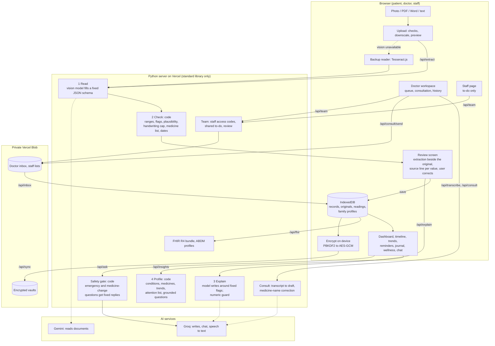

# Sehat Copilot

**Your health records, explained, organised, and connected to your doctor.**

Sehat Copilot is an AI-powered personal health copilot. Upload a prescription, lab report or discharge summary: it reads the document, checks every value against reference ranges, explains it in plain language (English, Hindi and eight more Indian languages), and files it into one health profile and timeline for you and your family. Reminders, a health journal, wellness trends and a doctor workspace keep that picture current between visits. Records export as an ABDM-style FHIR bundle.

Built by team **ANTIJAREX** for **HacXLerate 2026** (Altrix Labs challenge: *AI-Powered Personal Health Copilot*). Round 1 selected; this repository is the Round 2 build.

> Sehat Copilot explains records. It does not diagnose and is not a substitute for a doctor. In an emergency, call 112.

**Live:** https://sehat-copilot.vercel.app · **No sign-up needed:** each role has a one-click demo on the sign-in page.

---

## Contents

- [Try it in one minute](#try-it-in-one-minute)
- [What it does](#what-it-does)
- [Architecture](#architecture)
- [Safety by design](#safety-by-design)
- [Measured accuracy](#measured-accuracy)
- [Stack and files](#stack-and-files)
- [Run locally](#run-locally)
- [Tests and CI](#tests-and-ci)
- [What is real and what is mocked](#what-is-real-and-what-is-mocked)
- [Prior work and credits](#prior-work-and-credits)

## Try it in one minute

Open **/login** and pick a role. Every demo uses fictional people.

| Role | Demo button | What you see |
|---|---|---|
| **Patient** | Continue with demo account | The Mehra family (Rahul, Sunita, Aanya) with a year of records, readings, journal entries and medicines; switch members from the family chip |
| **Doctor** | Continue with doctor demo | Dr. R. K. Bansal's clinic: today's patients sorted by urgency, past consultations, patient history, prescriptions and a to-do list |
| **Nurse / staff** | Continue with nurse demo | The same clinic's to-do list as a nurse sees it: open tasks, history by date, nothing else |

A good path: patient dashboard → upload a report → review it beside the original → doctor demo → write a consultation note → approve → the prescription appears in the patient's app.

## What it does

### Round 1 brief: understand and organise records

| Brief requirement | Where |
|---|---|
| Medical record intelligence and OCR | Photo, PDF, Word (.docx) or text in; medicines, doses, test values, diagnoses and dates out, each with a confidence score and the exact line it was read from. Non-medical files are refused with a clear message |
| Summary in simple language | Every record gets a summary, a meaning for each abnormal value, the purpose of each medicine and questions to ask the doctor |
| Unified health profile | Timeline, conditions, recorded medicines, latest values and trend charts across reports, per family member |
| Multi-language (bonus) | Ten languages ship ready (English, Hindi, Bengali, Telugu, Marathi, Tamil, Gujarati, Kannada, Malayalam, Punjabi); 33 more are translated on demand. Hindi, mixed-language and handwritten documents are read |
| ABDM/ABHA readiness (bonus) | FHIR R4 bundle export shaped on NRCeS profiles; mock ABHA link that follows the ABDM steps (number, OTP, consent, choose records, import) |

### Round 2 brief: stay engaged between visits

| Need | Feature |
|---|---|
| Grounded chat | Ask about your own records; each answer is labelled *From your records*, *General information* or *Ask your doctor* |
| Medicine and appointment reminders | Built automatically from saved prescriptions: confirm, snooze (15 min, 1 h, pick a time), edit, skip; courses stop on their end date; follow-ups become visits; Google Calendar and .ics export |
| Personalised wellness, with reasons | Habits and suggestions drawn from the user's own logged data; low or high readings get safe first-aid guidance that always ends with "talk to your doctor" and never names a medicine |
| Trends, risk flags, next steps | Weekly, 30-day, 90-day and 1-year charts for readings and journal (sleep, mood, energy, pain); visits done, missed and upcoming; a pre-visit summary for the doctor |
| Agentic AI you can check | Every AI action (records read, reminders created) is shown with its source and can be edited or rejected before it takes effect |
| Voice | Speak a question or a journal entry; hear answers read aloud |
| Family profiles | Separate profiles with their own records and reminders, parental PIN for a child's profile, caregiver alerts when a member misses a dose |
| Sync across devices | End-to-end encrypted: the key is derived on the device and the server only ever stores ciphertext |

### Beyond the brief: the doctor side

| Feature | What it does |
|---|---|
| Today | Greeting and a live summary; daily counts; the queue sorted Major / Moderate / Minor from the complaint, with the reason shown and a doctor override |
| Consultation | Record, drop an audio file or type notes in any supported language; the AI drafts a prescription; misheard medicine names are corrected against the reference list, and ambiguous ones are flagged for the doctor instead of guessed; non-medical conversations are refused |
| Approve and send | The doctor edits every line and approves; the prescription reaches the matching family member's app, with reminders |
| Prescriptions and history | Every sent prescription with its recording and transcript; per-patient visits and prescriptions |
| Staff to-do | A PA, nurse or receptionist joins with a single-use code and can only read and update the to-do list; everything they add or complete waits in the doctor's daily review |

## Architecture



The data pipeline has four steps: **read**, **check**, **explain** and **profile**. Only steps 1 and 3 use a model. Step 2, step 4 and the safety gate are plain code, so the medical decisions are deterministic and testable.

## Safety by design

- **Code decides, the model writes.** Low, high and critical flags are computed in `ranges.py` from the range printed on the report (or a standard table). The model only words the explanation and cannot change a flag.
- **Numeric guard.** Every number in an explanation is checked against the verified record. A sentence with a number that is not in the record is replaced by a factual template.
- **Safety gate before the model.** Emergency wording gets a fixed reply pointing to 112. Questions about stopping, skipping or changing a medicine get a fixed "ask your prescriber" reply. Neither reaches a model. Medicine names are recognised in English, Hindi and Hinglish.
- **Guidance never prescribes.** Advice for low or high readings is first aid and lifestyle only, always ends with "talk to your doctor", and never names a medicine.
- **Every value is traceable.** Each test and medicine carries the line it was read from, shown under the value and beside the original.
- **Impossible values are caught.** A value no living adult has (an HbA1c of 76 %, say) is treated as a misread, never as critical, and the user is asked to check it.
- **Handwriting is never trusted.** For handwritten documents every item is capped below the "please verify" line.
- **Nothing is guessed.** Lines that could not be read reliably go to a "Lines not used" list and stay out of the record.
- **Human in the loop.** Nothing is saved until the user has seen the extraction beside the original. Nothing a doctor drafts reaches a patient until the doctor approves it.
- **Least access for staff.** Staff tokens can only reach the to-do list. Every other action is refused on the server. Codes are single use, and codes and tokens are stored only as hashes.
- **Privacy.** Records stay on the device by default. Sync is end-to-end encrypted. The upload screen says plainly that documents are read by third-party AI services. Designed around the consent and erasure principles of the DPDP Act 2023, not certified against it.

## Measured accuracy

`python tools/benchmark.py` scores the saved readings of the five bundled sample documents against what is printed on them.

| Field | Correct |
|---|---|
| Document type and date | 10 of 10 |
| Test found, value, and flag | 102 of 102 |
| Medicine found, strength, and frequency | 18 of 18 |
| Diagnosis found | 5 of 5 |
| No invented tests | 5 of 5 |
| **All fields** | **140 of 140** |

Read this narrowly: these are clean, printed, synthetic documents rendered by our own script. It is not a measure of accuracy on photographed paper or real handwriting, where we expect errors and rely on the review screen, the confidence cap and the plausibility guard.

**Doctor consultations.** Eight synthetic two-voice recordings (Hindi, Indian English, Hinglish, Tamil, Bengali, Marathi and two non-medical conversations) went through speech-to-text and drafting. All six consultations produced a draft and both non-medical recordings were refused. Two of thirteen medicine names were misheard ("telmezartin", "Prazole"). The first is now corrected automatically. The second is flagged for the doctor because three medicines are equally close.

## Stack and files

Python 3 standard library server (no framework, nothing to install), vanilla JavaScript frontend with no build step, Three.js for the decorative 3D helix, Gemini (document reading), Groq (writing, chat, speech to text), NVIDIA NIM and OpenRouter as fallbacks, Tesseract.js as the backup OCR, Vercel for hosting and private Blob storage.

| File | Role |
|---|---|
| `server.py`, `api/index.py` | HTTP API, local and Vercel entry |
| `pipeline.py` | extract, check, explain, overview, ask, consultation drafting, medicine-name correction |
| `ranges.py` | reference ranges, LOINC codes, flagging |
| `insights.py` | unified profile: conditions, medicines recorded, test series, attention list, grounded questions, cross checks |
| `safety.py` | emergency and medication gate, numeric guard |
| `llm.py` | model calls, key rotation and fallback chains |
| `fhir.py` | FHIR R4 bundle builder |
| `cloud.py` | encrypted vault storage and small app documents (private Blob, local files in development) |
| `team.py` | staff access codes, shared to-do list and doctor review |
| `clinic.py` | clinic prototype with server-side accounts (work in progress, see `V3-NOTES.md`) |
| `public/` | site (`/`, `/pricing`, `/login`), patient app (`/app`), doctor workspace (`/doctor.html`), staff page (`/staff.html`) |
| `public/*.js` | one file per feature: `family`, `reminders`, `journal`, `wellness`, `voice`, `bulk`, `sync`, `inbox`, `doctor`, `fx` |
| `tests/` | unit and HTTP tests |
| `tools/` | sample-document generator, benchmark, demo builders, interface translators, demo-video tooling |

## Run locally

```bash
python server.py
```

Then open http://localhost:8820 (set `PORT` to change it). Create a `.env` with `GEMINI_API_KEY` and `GROQ_API_KEY`. `NVIDIA_API_KEY`, `OPENROUTER_API_KEY` and `BLOB_READ_WRITE_TOKEN` are optional. Without a Blob token, sync vaults, the doctor inbox and staff lists are kept in `data/` on disk.

On localhost, `/app?seed=1` fills a year of fictional family data, and `/app?seed=reset` removes exactly what it added.

## Tests and CI

```bash
python -m pytest tests
```

There are 347 tests (341 run, 6 skipped) covering the safety gate, labels, numeric guard, ranges, extraction normalisation, date repair, reminders logic, sync storage, consultation drafting and staff access rules. CI (`.github/workflows/ci.yml`) runs flake8, a bandit security scan and the test suite on every push.

Known state: the HTTP tests for the in-progress clinic prototype (`tests/test_clinic_v3.py`) are skipped, with the reason stated, until its routes are merged into `server.py`. Everything else passes.

## What is real and what is mocked

- **Real:** document reading, range checking, explanations, timeline, trends, reminders, journal, grounded chat, voice, family profiles, encrypted sync, FHIR export, consultation transcription and drafting, doctor-to-patient delivery, staff to-do access.
- **Mocked:** the ABHA link and import. It validates the number format and returns canned records; it does not call the ABDM sandbox.
- **Fictional data:** every sample document, demo profile, doctor, nurse and patient is synthetic. Sample images carry a "SAMPLE" footer.
- **Accounts:** patient and doctor accounts are stored in the browser (passwords only as salted hashes); there is no server-side login yet. Staff access is server-side with single-use codes. The clinic prototype adds server-side accounts and is being merged.
- **Reference ranges** are general adult ranges for explanation only.
- **Translations:** labels for the eight languages other than English and Hindi are machine-translated and not checked by native speakers. The Hindi safety replies were written by the team with AI help and have not been reviewed by a clinician or a professional translator.
- **Pricing** is illustrative: nothing is charged.
- **Not clinician-reviewed:** the medicine cross-checks, the urgency rules in the doctor queue and the first-aid guidance. Each one describes the situation and never instructs.

## Prior work and credits

`data/medicines.json` (135 medicines with brand names, classes, uses and interaction notes) comes from our earlier project, CarePath. Three.js (MIT licence, vendored as `public/vendor/three.module.js`) draws the decorative DNA helix. The site pages follow the visual rhythm of CarePath's landing page, but their markup and copy were written for this project. Everything else was written during the hackathon by team ANTIJAREX, built with an AI coding assistant as the rules allow.
